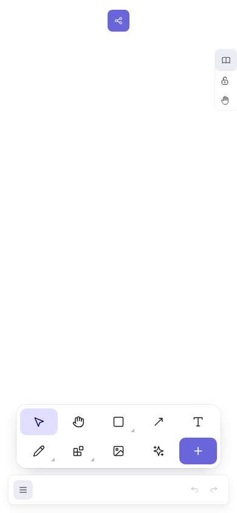
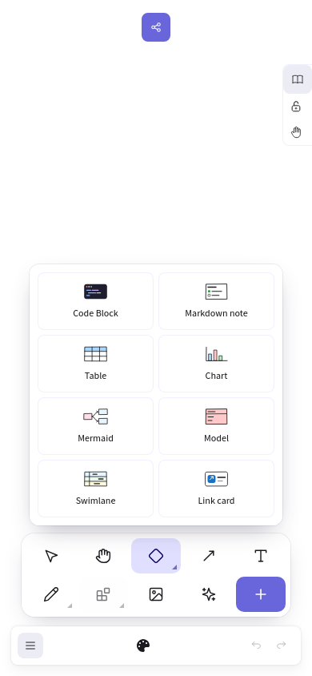
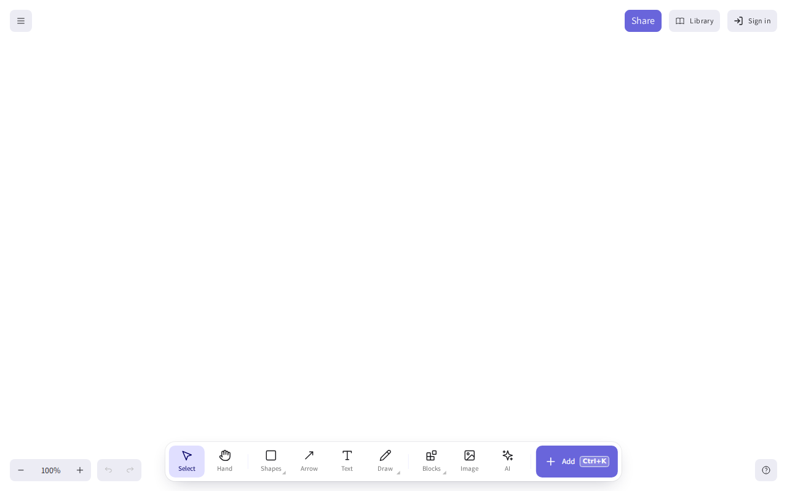

# Mobile toolbar regression (#4)

## Change

The dock was mounted inside Excalidraw's desktop-only footer. Phones therefore kept the old,
wide toolbar. Mount the dock in the editor root, preserve its desktop footer alignment and
place it above the native mobile bottom bar. Phone controls use two rows with at least
44 × 44 px targets. Group menus stay centred within the screen and scroll when height is
limited. Native menu, undo/redo, zoom, collaboration and library controls are preserved.

## Verification

All final installation, builds, tests and browser runs were executed on a disposable Hetzner
CPX22 via devbox, with Node 24.22.2 and pnpm 10.34.9. No production credentials or data.

- `pnpm typecheck`: passed.
- `pnpm lint`: passed (0 errors, 72 existing warnings; changed source files have no warnings).
- `pnpm test`: passed (50 tests).
- `pnpm build`: passed (existing chunk-size/dynamic-import warnings).
- Prettier check of changed source files and the browser script: passed.
- `scripts/mobile-toolbar.e2e.mjs`: passed 10 browser/viewport combinations on the public
  preview: Chromium and WebKit, each at 320×568, 390×844, 844×390, 1280×800 and 900×700.
- Checks include actual device-mode activation, all ten buttons within the viewport,
  minimum phone touch targets, no overlap with native bottom controls, selecting Diamond,
  opening the eight-item Blocks menu, menu bounds, Escape dismissal and no page errors.
- Regression sensitivity: restoring the original `native-dock.ts` makes the first phone
  test fail because the dock does not mount. Restoring the fix makes the suite pass again.

WebKit is Playwright's desktop-hosted engine with mobile emulation, **not a physical
Safari/iPhone test**. OAuth, paid AI calls, image upload and collaboration were not exercised.
The preview disables local sign-in and has no AI credentials.

The 4 GB devbox initially killed the Vite process during a full build due to memory
pressure. Added 2 GB swap on the devbox, restarted Vite and reran the public-preview browser
suite successfully. No application processes or browsers were run on the Hermes host during
this verification.

## Reproduce the browser checks

With the app/API running, install Playwright outside the workspace (avoids lockfile changes):

```sh
mkdir -p /srv/qa
npm install --prefix /srv/qa playwright
/srv/qa/node_modules/.bin/playwright install --with-deps chromium webkit
PLAYWRIGHT_PACKAGE=/srv/qa/node_modules/playwright/index.mjs \
BASE_URL=http://localhost:3005 \
EVIDENCE_DIR=/srv/qa/evidence \
node scripts/mobile-toolbar.e2e.mjs
```

## Screenshots

Captured by browsers running on the devbox against the public preview.

### Mobile WebKit, 390×844



### Mobile WebKit, Blocks menu



### Desktop Chromium, 1280×800


